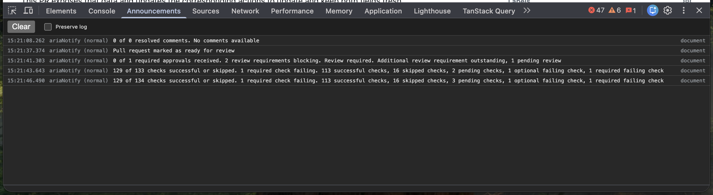

# announcements-devtools-extension

Devtools extension for observing ARIA announcements.

Adds an **Announcements** tab to browser DevTools that logs, as they happen:

- Calls to [`ariaNotify`](https://github.com/MicrosoftEdge/MSEdgeExplainers/blob/main/Accessibility/AriaNotify/explainer.md) on elements and the document (when supported by the browser).
- Changes to ARIA live regions: elements with `aria-live="polite"` / `aria-live="assertive"`, live roles (`alert`, `status`, `log`), and `<output>` elements. `aria-atomic` and `aria-relevant` are respected, and inserted `role="alert"` elements are logged too.

Assertive announcements (`aria-live="assertive"`, `role="alert"`, and `ariaNotify` with `priority: "high"`) are shown in **bold**. Use **Clear** to empty the log, and **Preserve log** to keep entries across page navigations.

## Installing (unpacked)

The extension targets Chromium-based browsers (Chrome, Edge) version 111 or newer.

1. Clone this repository.
2. Open `chrome://extensions` (or `edge://extensions`).
3. Turn on **Developer mode**.
4. Click **Load unpacked** and select the [`extension`](./extension) directory.
5. Open DevTools on any page and select the **Announcements** tab. Pages that were already open before you installed the extension need to be reloaded.

After changing the extension's files, click the reload button on the extension's card in `chrome://extensions`, then reload the inspected page and reopen DevTools.

## Demo

Open [demo/index.html](./demo/index.html) in a browser to try all three `aria-live` values,
the live roles (`alert`, `status`, `log`, `marquee`, and `timer`), native `<output>`,
and document/element `ariaNotify` calls (when supported).
Each bordered region has add, update, remove, and clear controls, plus `aria-atomic`,
`aria-relevant`, and `aria-busy` settings. Use a screen reader or the Announcements tab
to observe the results; `off`, `marquee`, and `timer` are intentionally not live by default.
When using a local file, enable **Allow access to file URLs** in the extension's details
to let the Announcements tab observe it.

## Limitations

- This logs what the page _asks_ to be announced. It doesn't use a screen reader, so actual speech output may differ depending on the assistive technology.
- Live regions inside shadow roots aren't observed.
- Content added while the page is still loading isn't logged, because screen readers don't announce it either.
